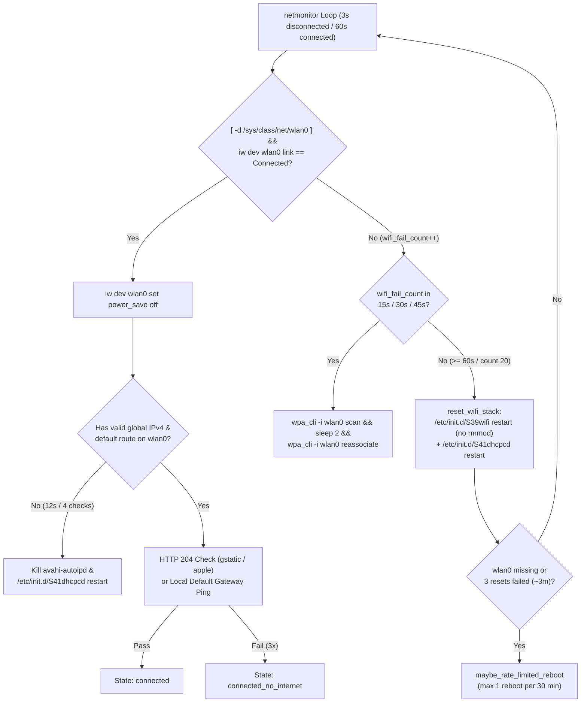

# ThirdReality Home Assistant Speaker (`3RAB01090D`) Firmware Hardening & Self-Healing Patches

Persistent OverlayFS reliability, Wi-Fi/SDIO self-healing, DHCP, D-Bus, and Voice Assistant patches for the **ThirdReality Linux Voice Assistant Smart Speaker (`3RAB01090D`, Firmware `1.02.04`)**.


[](https://ko-fi.com/russellmilliner)

> 🤖 **100% AI-Diagnosed & Developed:** Every root-cause analysis, live `dmesg`/ADB investigation, `aarch64` disassembly of `/usr/bin/multi_wifi_load_driver`, OverlayFS firmware patch, and deployment script in this repository was **completely diagnosed and developed by AI (`Google Gemini 4 Argon`)**.
>
> ☕ **Found these patches helpful?** Support by buying Russell Milliner a coffee on Ko-fi: **[https://ko-fi.com/russellmilliner](https://ko-fi.com/russellmilliner)**

> [!CAUTION]
> **DISCLAIMER — UNSUPPORTED BY THE AUTHOR OR VENDOR (USE AT YOUR OWN RISK):**
> These patches, scripts, and instructions were **completely diagnosed and generated by AI (`Google Gemini 4 Argon`)** as unofficial, independent modifications and are **completely unsupported by both the repository owner (Russell Milliner) and the hardware vendor (ThirdReality, Inc.)**. Modifying embedded Linux init scripts and OverlayFS system files over ADB is done **entirely at your own risk** and may void your hardware warranty, cause network connectivity loss, or conflict with future vendor OTA firmware updates. This repository is provided **"AS IS"**, without warranty, guarantee, or technical support of any kind.

---

## 1. Overview & Hardware Architecture

The **ThirdReality Home Assistant Speaker (`3RAB01090D`)** is an Amlogic `A113X` (`aarch64`) embedded Linux smart speaker running Buildroot (`Linux 5.4.180`), `linux-voice-assistant-cpp` (ESPHome API on TCP `:6053` + Sendspin music player on TCP `:8928`), and an Ampak `AP6212A` (`Broadcom BCM43438` SDIO Wi-Fi/BLE) radio.

| Component | Specification / Path |
| :--- | :--- |
| **Model / Stock Firmware** | `ThirdReality 3RAB01090D` / Firmware `1.02.04` (`linux-voice-assistant-cpp` / ESPHome `2025.9.0`) |
| **SoC / Kernel** | Amlogic `AXG A113X S420` (`aarch64`), `Linux 5.4.180` |
| **Wi-Fi / Bluetooth Radio** | Ampak `AP6212A` (`Broadcom BCM43438A1` 2.4 GHz 802.11b/g/n) on SDIO bus `ffe05000.sdio` (`mmc0:0001`), driver `/lib/modules/5.4.180/kernel/drivers/amlogic/wifi/bcmdhd/dhd.ko` |
| **Root Filesystem Layout** | Read-only UBIFS base image mounted at `/rom` (`/dev/ubi0_0`) with read-write persistent UBIFS OverlayFS upper layer at `/data/overlay/upper` (`/dev/ubi1_0`) |
| **Management Interface** | Root shell over Android Debug Bridge (`adb connect <speaker_ip>:5555`) |
| **Primary Services** | `/etc/init.d/S99ha-speaker` -> `/usr/share/thirdreality/script/netmonitor` + `/usr/bin/linux-voice-assistant-cpp --port 6053` + `pulseaudio` |

---

## 2. Root Cause Analysis: 7 Bugs Causing Offline & Unresponsive Speakers

In stock firmware `1.02.04`, speakers periodically drop off Wi-Fi or become unresponsive in Home Assistant for days until physically unplugged. Investigation of the live filesystem, kernel ring buffer (`dmesg`), and `aarch64` disassembly of `/usr/bin/multi_wifi_load_driver` uncovered **7 distinct bugs**:

| # | Bug / Component | Stock `1.02.04` Behavior | Patched `1.02.04+milliner2` Behavior |
| :--- | :--- | :--- | :--- |
| **1** | **`netmonitor` Has Zero Wi-Fi or DHCP Recovery** (`/usr/share/thirdreality/script/netmonitor`) | `netDownAction()` only writes `"status": "disconnected"` to `/data/conf/device.json` and touches `/tmp/net_disconnected` (causing the speaker's LED ring to flash red when tapped). It **never** calls `wpa_cli`, never restarts `udhcpc`, and never resets `wlan0`. Once Wi-Fi or DHCP drops, the speaker stays offline forever until unplugged. | Implements a multi-stage self-healing state machine: triggers `wpa_cli -i wlan0 scan` + `reassociate` at `15s`, `30s`, and `45s`, resets `wlan0` (`dhd_stop`/`dhd_open`) + `wpa_supplicant` + `udhcpc` at `60s`, auto-recovers missing DHCP leases after `12s`, and performs a rate-limited hardware reboot (max once per 30m) if `wlan0` remains unrecoverable after 3 reset cycles. |
| **2** | **`multi_wifi_load_driver` 10ms SDIO Enumeration Race & Permanent `SDIO_POWER_DOWN`** (`/etc/init.d/S39wifi` & `/usr/bin/multi_wifi_load_driver`) | `S39wifi stop` calls `multi_wifi_load_driver station 0`, which unloads `dhd.ko` and issues `ioctl(/dev/wifi_power, 0x6d04)` (`SDIO_POWER_DOWN`), removing `mmc0:0001`. When `S39wifi start` runs `multi_wifi_load_driver station 1`, it calls `ioctl(0x6d03)` (`SDIO_POWER_UP`), sleeps only **10 ms** (`usleep(10000)` at `0x29c8`), and checks `/sys/bus/mmc/devices/mmc0:0001/mmc0:0001:1/device`. Because `meson-gx-mmc` takes **220–245 ms** to re-enumerate SDIO, the check fails at 10 ms, falls into a 15s USB fallback loop (`0x2a00`), and calls **`ioctl(0x6d04)` (`SDIO_POWER_DOWN`) at `0x2a68`**, permanently powering off the Wi-Fi chip! | `S39wifi stop` / `restart` no longer calls `multi_wifi_load_driver station 0`, and `S39wifi start` only calls `multi_wifi_load_driver station 1` if `/sys/class/net/wlan0` does not exist yet. Cycling `ifconfig wlan0 down` -> `ifconfig wlan0 up` invokes `dhd_stop` and `dhd_open` (`wl_android_wifi_on`, `WL_REG_ON` + 200ms delay + `sdio_sw_reset` + `fw_bcm43438a1.bin` firmware reload) safely inside `dhd.ko` without unloading the module or removing `mmc0:0001`. |
| **3** | **Inverted `ssidCheck()` False Positive When `wlan0` Is Missing** (`/usr/share/thirdreality/script/netmonitor`) | Stock `ssidCheck()` runs `if iw dev wlan0 link 2>/dev/null \| grep -q "Not connected"; then return 1; else return 0; fi`. When `wlan0` does not exist (`No such device (-19)` on stderr), stdout is **empty**, so `grep -q "Not connected"` returns `1` and `ssidCheck()` returns **`0` (connected!)**, permanently blinding `netmonitor`. | Replaced `ssidCheck()` with `[ -d /sys/class/net/wlan0 ] && iw dev wlan0 link 2>/dev/null \| grep -q "^Connected to "`, requiring `wlan0` to exist and actively report an associated BSSID. |
| **4** | **Broadcom `dhd.ko` Wedges on UniFi `Lock to AP` Rejections (`status=769`)** (UniFi Controller + `dhd.ko`) | When a speaker is locked to a specific AP in UniFi (`fixed_ap_enabled: true`) and that AP reboots or deauths, `wpa_supplicant` attempts to roam to a neighboring AP, which rejects the 802.11 Association Request with `status=769`. This triggers a bug in `dhd.ko` (`wl_handle_assoc_fail : Event:0 Wrong bssid:00:00:00:00:20:00` -> `DISCONNECING clean up failed!`), wedging the driver's state machine. | Documented the required UniFi configuration (`fixed_ap_enabled: false`) and added automatic `dhd_stop`/`dhd_open` state-machine reset in `S39wifi` + `netmonitor` if `dhd.ko` ever enters a stuck disconnecting state. |
| **5** | **Non-Executable (`0644`) BCM43438 Power-Save Hook** (`/usr/share/udhcpc/default.script.d/disable-wifi-powersave`) | ThirdReality included a hook to run `iw dev wlan0 set power_save off` after DHCP (noting that BCM43438 power save causes 100–500 ms latency spikes), but shipped the file with mode **`0644` (`-rw-r--r--`)**. Because `/usr/share/udhcpc/default.script` checks `[ -f "${hook}" -a -x "${hook}" ] \|\| continue`, the hook was **never executed**, leaving `power_save on`. | Sets `chmod 0755` on `/usr/share/udhcpc/default.script.d/disable-wifi-powersave` and additionally enforces `iw dev wlan0 set power_save off` in `S39wifi` and `netmonitor`. |
| **6** | **Aggressive 3s DHCP Timeout & `2&>1` Redirection Bug** (`/etc/init.d/S41dhcpcd`) | Stock `S41dhcpcd` ran `/sbin/udhcpc -i wlan0 -A 1 -T 1 -b` (1s timeout), causing brief Wi-Fi roams to fall back to `avahi-autoipd` (`169.254.x.x`). Line 10 also contained `kill -9 $(pidof udhcpc) > /dev/null 2&>1`, a shell syntax bug that backgrounded `kill ... 2` and wrote a stray file `/1` into `/data/overlay/upper/1`. | Fixed redirection to `2>&1`, removed `/data/overlay/upper/1`, created `/var/lib/ntp` (stopping `ntpd` drift-file errors every 2 hours), and relaxed `udhcpc` to `-i wlan0 -A 5 -T 3 -t 5 -b`. |
| **7** | **`S49ntp` vs `S99ha-speaker` Boot Race, Missing `:6053` Watchdog & `/var/pulse` UBIFS Leak** (`S99ha-speaker` & `S30dbus`) | 1) `S49ntp` runs `ntpdate.sh &` in the background (which deletes `/tmp/ha_disable_voice` once NTP syncs), while `S99ha-speaker` runs later and unconditionally executes `touch /tmp/ha_disable_voice`. If `ntpdate.sh` finishes first, voice assistant never starts.<br>2) `S99ha-speaker` only checked `kill -0` on `voice-assistant.pid` without checking if TCP `:6053` was actually listening.<br>3) Because `/var/lib/dbus` is a symlink to `/tmp/dbus` (`tmpfs`), `S30dbus` generated a new random 32-byte `machine-id` on every boot, leaking 4 new `<machine-id>-*.simple` files into `/var/pulse` on UBIFS flash per reboot (565+ leaked files). | 1) `S99ha-speaker` only sets `DISABLE_VOICE` at boot if `ntpd` is not yet running, and clears stale boot locks in `monitor_loop`.<br>2) Monitors `netstat -tlne \| grep -q ":6053 "` and restarts `linux-voice-assistant-cpp` if port `:6053` stops listening for 30s.<br>3) `S30dbus` and `S99ha-speaker` persist `/etc/machine-id` across reboots and automatically prune orphaned `/var/pulse/*` files on startup. |

---

## 3. Technical Deep Dive: Why Stock `S39wifi restart` Kills SDIO Wi-Fi

Disassembly of `/usr/bin/multi_wifi_load_driver` (`aarch64`) on Firmware `1.02.04` shows the exact sequence executed during `multi_wifi_load_driver station 1`:

```text
0x2954: mov  w1, #0x6d03                  ; SDIO_POWER_UP ioctl command
0x2964: bl   ioctl                        ; ioctl(/dev/wifi_power, 0x6d03) -> powers on mmc0
0x29b0: bl   get_usb_device_id            ; checks /sys/bus/mmc/devices/mmc0:0000
0x29c0: mov  w0, #0x2710                  ; 10,000 microseconds = 10 ms!
0x29c8: bl   usleep                       ; sleeps only 10 ms
0x29cc: bl   sdio_get_Vendor_id           ; opens /sys/bus/mmc/devices/mmc0:0001/mmc0:0001:1/device
0x29d4: cbz  w0, 0x2a00                   ; if not found at +10 ms, jump to USB fallback loop!
...
0x2a00: add  x20, sp, #0x4bc              ; "wait usb ok" loop (300 iterations * 50 ms = 15s)
...
0x2a68: bl   set_wifi_power (0)           ; calls ioctl(/dev/wifi_power, 0x6d04) SDIO_POWER_DOWN!
```

On the Amlogic `meson-gx-mmc` controller (`ffe05000.sdio`), re-enumerating `mmc0:0001` after `SDIO_POWER_UP` takes **220–245 ms**:

```text
[   12.011002] meson-gx-mmc ffe05000.sdio: actual clock : 400000, HHI_nand: 0x80
[   12.238922] meson-gx-mmc ffe05000.sdio: actual clock : 50000000, HHI_nand: 0x802
[   12.243916] mmc0: new high speed SDIO card at address 0001
```

Because `multi_wifi_load_driver station 1` only waits **10 ms** (`0x2710` us), `/sys/bus/mmc/devices/mmc0:0001` never exists in time after `S39wifi stop` unloads `dhd.ko`. It then spends 15 seconds polling for a non-existent USB Wi-Fi dongle and calls `ioctl(0x6d04)` (`SDIO_POWER_DOWN`), turning off power to the BCM43438 chip until the speaker is physically power-cycled.

By keeping `dhd.ko` loaded and using `ifconfig wlan0 down` -> `ifconfig wlan0 up`, `dhd_open()` runs `wl_android_wifi_on()` inside the kernel driver, which toggles `WL_REG_ON` with a proper 200ms delay, resets the SDIO function (`sdio_sw_reset`), and re-downloads `fw_bcm43438a1.bin` + `nvram_ap6212a.txt` to dongle RAM in ~1.1 seconds.

---

## 4. Self-Healing Network Monitor Workflow (`netmonitor` v2)



---

## 5. Repository Layout

| Path | Description |
| :--- | :--- |
| [`files/etc/init.d/S30dbus`](./files/etc/init.d/S30dbus) | Hardened D-Bus init script that persists `/etc/machine-id` across reboots |
| [`files/etc/init.d/S39wifi`](./files/etc/init.d/S39wifi) | Hardened Wi-Fi init script (prevents `multi_wifi_load_driver station 0` SDIO power-down race and disables `wlan0` power save) |
| [`files/etc/init.d/S41dhcpcd`](./files/etc/init.d/S41dhcpcd) | Hardened `udhcpc` init script (fixes `2&>1` redirection bug, creates `/var/lib/ntp`, increases DHCP timeout to `-A 5 -T 3 -t 5`) |
| [`files/etc/init.d/S99ha-speaker`](./files/etc/init.d/S99ha-speaker) | Hardened service supervisor (fixes `DISABLE_VOICE` NTP boot race, adds TCP `:6053` watchdog, exports D-Bus/XDG env, prunes `/var/pulse`) |
| [`files/usr/share/thirdreality/script/netmonitor`](./files/usr/share/thirdreality/script/netmonitor) | Hardened self-healing network monitor v2 (fixes `ssidCheck()` false positive, adds staged `wpa_cli` / `S39wifi` / `S41dhcpcd` / reboot recovery and local gateway fallback) |
| [`files/usr/share/udhcpc/default.script.d/disable-wifi-powersave`](./files/usr/share/udhcpc/default.script.d/disable-wifi-powersave) | Executable (`0755`) DHCP bound/renew hook that disables BCM43438 Wi-Fi power save |
| [`stock-1.02.04/`](./stock-1.02.04/) | Unmodified stock Firmware `1.02.04` reference files extracted from `/rom` |
| [`patches/thirdreality-speaker-1.02.04-hardening.patch`](./patches/thirdreality-speaker-1.02.04-hardening.patch) | Unified diff (`diff -ruN`) comparing `stock-1.02.04/` against `files/` |
| [`scripts/apply-speaker-patches.sh`](./scripts/apply-speaker-patches.sh) | Automated over-the-air ADB installer (`--wait` and `--dry-run` supported) |
| [`scripts/check-speaker-status.sh`](./scripts/check-speaker-status.sh) | Diagnostic health reporter and SHA-256 patch verifier |
| [`scripts/revert-speaker-patches.sh`](./scripts/revert-speaker-patches.sh) | Reverts OverlayFS upper-layer overrides back to stock `/rom` files |

---

## 6. Usage & Deployment Instructions

### Prerequisites

- `adb` (`android-tools` / `adb`) installed on your workstation
- Network reachability to the speaker's IPv4 address (TCP port `5555` is open by default on ThirdReality `3RAB01090D` speakers)
- **UniFi / Wi-Fi Controller Recommendation**: Ensure **Lock to Access Point (`fixed_ap_enabled`)** is **disabled** for the speaker's MAC address so neighboring APs never reject roam attempts with 802.11 status code `769`.

### 1. Check Current Speaker Status & Patch State

```bash
./scripts/check-speaker-status.sh 192.168.1.250 192.168.0.250
```

Example output:

```text
--------------------------------------------------------------------------------
Speaker Diagnostic Report: 192.168.1.250
--------------------------------------------------------------------------------
  Device Name      : 3RSPK-A8E29151C8D1 (3RAB01090D)
  Firmware / Kernel: 1.02.04 / Linux 5.4.180
  Uptime           :  17:10:05 up 44 min,  load average: 2.17, 1.99, 1.77
  wlan0 MAC / IPv4 : a8:e2:91:51:c8:d1 / 192.168.1.250/23 (gw: 192.168.0.1)
  Wi-Fi Link       : SSID=MyHomeWiFi, BSSID=2e:70:4e:31:30:ba, Signal=-28 dBm
  Wi-Fi Power Save : off (udhcpc hook mode: executable (+x))
  netmonitor State : connected
  D-Bus machine-id : /etc=388469b27ed09b44a9d023da6ae2c934 (matches /var/lib/dbus: YES)
  /var/pulse Files : 5 files
  TCP Ports        : :6053 (ESPHome API)=LISTENING, :8928 (Sendspin)=LISTENING
  Patch Checksums  :
    [OK]       /etc/init.d/S30dbus
    [OK]       /etc/init.d/S39wifi
    [OK]       /etc/init.d/S41dhcpcd
    [OK]       /etc/init.d/S99ha-speaker
    [OK]       /usr/share/thirdreality/script/netmonitor
    [OK]       /usr/share/udhcpc/default.script.d/disable-wifi-powersave
[+] All 6 hardened patches verified on 192.168.1.250.
```

### 2. Apply Patches to One or More Speakers

```bash
./scripts/apply-speaker-patches.sh 192.168.1.250 192.168.0.250
```

If a speaker is currently wedged offline and needs to be power-cycled, run with `--wait` and then unplug/replug the speaker—the script will automatically detect when it comes online and deploy the patches immediately:

```bash
./scripts/apply-speaker-patches.sh --wait 192.168.1.250
```

To preview which files would change without modifying the speaker:

```bash
./scripts/apply-speaker-patches.sh --dry-run 192.168.1.250
```

### 3. Revert a Speaker to Stock Firmware Files

Because all modifications reside in `/data/overlay/upper` on top of the read-only `/rom` UBIFS image, you can revert to stock `1.02.04` at any time:

```bash
./scripts/revert-speaker-patches.sh 192.168.1.250
```

---

## 7. Support & Buy Me a Coffee

If these fixes saved your ThirdReality Home Assistant Speakers from dropping offline or needing constant power-cycles, consider buying me a coffee!

[](https://ko-fi.com/russellmilliner)

- **Ko-fi**: [https://ko-fi.com/russellmilliner](https://ko-fi.com/russellmilliner)

---

## 8. AI Attribution, Disclaimer & No-Support Notice

- **Completely Diagnosed & Developed by AI (`Google Gemini 4 Argon`)**: All live device diagnostics, kernel/driver log correlation, `aarch64` ELF binary disassembly (`/usr/bin/multi_wifi_load_driver`), shell script hardening, and deployment tooling in this repository were **100% autonomously diagnosed and developed by AI (`Google Gemini 4 Argon`)**.
- **Not Affiliated with or Supported by Vendor**: This project is an independent reverse-engineering and reliability effort. It is **not** affiliated with, endorsed by, or supported by **ThirdReality, Inc.**, **Nabu Casa**, or the **Home Assistant** project.
- **No Author Support**: These scripts and patches are shared strictly as a reference for advanced users and are **not supported by the author**.
- **Use at Your Own Risk**: Everything in this repository is provided **"AS IS"**, without warranty of any kind, express or implied. Applying modifications to your speaker's `/data/overlay/upper` filesystem over ADB is performed **entirely at your own risk**. The author assumes no liability for bricked devices, network disruptions, voided warranties, or unexpected behavior across firmware versions.

